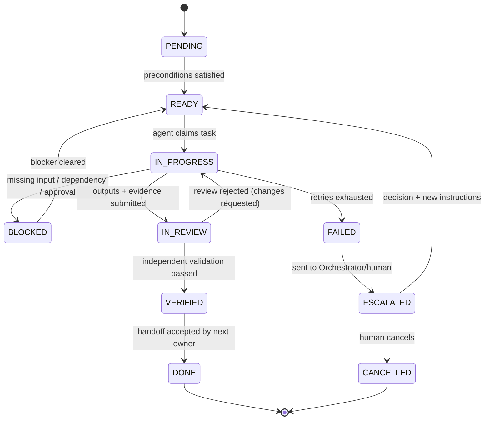

## 8.2 Task lifecycle and workflow state

**Rules**
- `DONE` requires `VERIFIED`, which requires evidence plus independent review.
- Where an agent's account of its own actions conflicts with timestamps, version-control history (for example `git log`) or tool output, the latter prevails and the conflict is logged as a finding.
- The reviewer SHOULD use a different model or tool than the author where possible, to reduce shared blind spots.
- An agent may never move a task to `VERIFIED` by itself.
- Any change to a task's inputs after `VERIFIED` returns it to `READY` (re-validation) if the change could invalidate the evidence.
