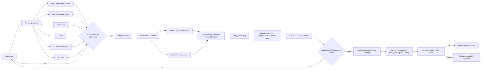

# PART 13 — CI/CD AND DEPLOYMENT STANDARDS

## 13.1 Pipeline architecture

**Principles.** *Build once, promote the same digest* (never rebuild per environment). Everything is automated, and the production deployment is **only** from the pipeline. Pipeline definitions are code, are reviewed, and are protected by CODEOWNERS.
