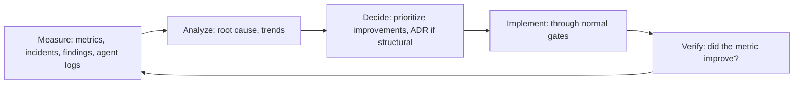

# PART 15 — CONTINUOUS IMPROVEMENT FRAMEWORK

## 15.1 Improvement loop

## 15.2 Metrics

| Category | Metric | Use |
|---|---|---|
| Delivery (DORA) | Deployment frequency, lead time for changes, change failure rate, time to restore | The flow and the stability |
| Quality | Escaped defects, defect density, the flaky rate, the coverage trend, and the mutation score | The test effectiveness |
| Security | Open vulnerabilities by severity and age, SLA compliance, the mean time to remediate, the secrets-leak count, the detection coverage (ATT&CK), the mean time to detect and to respond | The posture |
| Reliability | SLO attainment, error-budget burn, incident count and the duration | The operational health |
| Process (agent) | Gate first-pass rate, the rework rate, the retries per task, the escalations, the blocked-time, and the evidence-completeness rate | The agent workflow health |
| Maintainability | Complexity, the duplication, the dependency freshness, and the debt trend | The long-term cost |

Metrics are **diagnostic, not targets to game**. If a metric becomes a target, supplement it with a counter-metric (for example, the deployment frequency with the change failure rate).

## 15.3 Review cadence

| Review | Frequency | Output |
|---|---|---|
| Retrospective | Each iteration or release | The action list |
| Architecture fitness review | Quarterly | The drift report and the ADR updates |
| Security reassessment | Annually, and on a major change | The updated threat model and the test report |
| Dependency and technology radar | Quarterly | The upgrade and the adoption plans |
| Manual (this document) review | Annually, and after a major incident | The amendments, justified by the data |

## 15.4 Improvement roadmap structure (Phase 11 deliverable)

| Section | Content |
|---|---|
| Current state | The metrics and the key findings |
| Themes | Security, reliability, performance, the maintainability, the developer and the agent experience |
| Initiatives | For each: the problem, the proposed change, the expected measurable outcome, the effort, the risk, the owner, and the target date |
| Dependencies and sequencing | |
| Review date | |

---
